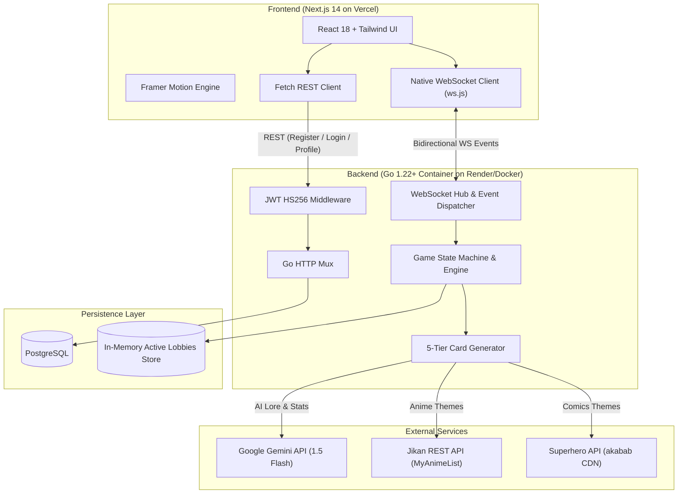
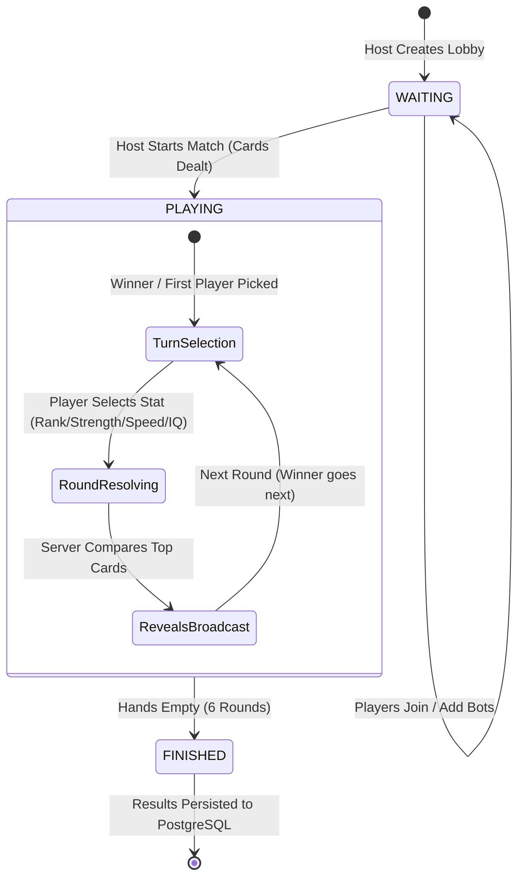

# KaijuCards ⚔️🎴

> A real-time, server-authoritative multiplayer card battle game with dynamic AI stat generation and live WebSocket lobbies.

Built by [Juixe7](https://github.com/Juixe7).

[](https://github.com/Juixe7/KaijuCards/actions/workflows/ci.yml)
[](LICENSE)

---

## 💡 Why I Built This

I wanted to build a card battling experience that blends the nostalgia of classic Top Trumps / anime battle cards with modern web technologies and generative AI. Most web card games either rely on static, pre-defined decks or rely too heavily on client-side state where players can easily inspect or manipulate stats and turn order.

With **KaijuCards**, I set out to solve three core engineering challenges:
1. **Server-Authoritative Fairness:** The client acts as a pure renderer and action dispatcher. Round resolution, card dealing, finite-state transitions, and stat evaluations are strictly governed on the backend through a Go Finite State Machine (FSM). Client manipulation is physically impossible.
2. **Infinite Multiverse Replayability:** Instead of being restricted to fixed cards, players can enter *any* anime, comics, or fictional universe theme (e.g. *One Piece*, *Jujutsu Kaisen*, *Marvel*, *Godzilla*). The game dynamically fetches characters and leverages Google Gemini to generate balanced, lore-accurate power stats on the fly.
3. **Low-Latency Real-Time Gameplay:** Using Go channels, goroutines, and WebSockets, game moves and room updates propagate in sub-10ms with smooth Framer Motion table animations.

---

## 🏛️ System Architecture

KaijuCards is architected as a decoupled, high-performance stack:



---

## 🃏 5-Tier Resilient Card Pipeline

Generating dynamic cards on the fly comes with API rate-limit risks and downtime. To ensure matches never fail, KaijuCards uses an automatic 5-tier fallback cascade:

```
[Requested Theme]
       │
       ▼
1. Curated Decks (Hand-crafted starter packs like One Piece & Pokémon)
       │ (Cache Miss)
       ▼
2. Jikan Anime API (Character portraits & favorite counts)
       │ (Timeout / Not Anime)
       ▼
3. Superhero CDN (700+ Marvel / DC comic characters with native stats)
       │ (Not Comic / Rate limited)
       ▼
4. Google Gemini 1.5 Flash (Generates 24 universe characters with lore-accurate stats)
       │ (No API key / Quota reached)
       ▼
5. FNV-1a Deterministic Hash (Guaranteed seed-based stat generation)
```

---

## ⚡ Game Loop & Finite State Machine

The game engine is governed by a strict state machine preventing out-of-order execution or cheating:



---

## 📸 Screenshots

| Lobby & Universe Forge | Live Combat Arena |
| :---: | :---: |
|  |  |

| Radial Seating & Hand View | Victory Screen |
| :---: | :---: |
|  |  |

---

## 🛠️ Tech Stack

| Component | Technology | Why Chosen |
| :--- | :--- | :--- |
| **Backend** | Go (Golang 1.22+) | Unmatched concurrency with goroutines and channels; minimal memory footprint |
| **Realtime** | Gorilla WebSocket | High-throughput, thread-safe bidirectional socket pumps |
| **Frontend** | Next.js 14 (React 18) | Hybrid static export, snappy client-side routing |
| **Styling** | TailwindCSS + Synthwave Custom Felt | Custom retro synthwave aesthetic with glassmorphism panels |
| **Animation** | Framer Motion | Physics-based spring animations for card flipping and hand fanning |
| **Database** | PostgreSQL 16 | ACID-compliant match history and user profile metrics |
| **AI Layer** | Google Gemini 1.5 Flash | Lore-accurate power attribute estimation in <1.5s |

---

## 🚀 Getting Started

### Prerequisites
* **Go 1.22+**
* **Node.js 18+**
* **PostgreSQL 16+** (or Docker)

### Option 1: Run with Docker Compose (Recommended)

```bash
# Clone the repository
git clone https://github.com/Juixe7/KaijuCards.git
cd KaijuCards

# Create .env with your Gemini API Key
cp .env.example .env

# Spin up Postgres, Go Backend, and Next.js Frontend
docker compose up --build
```
* **Frontend:** `http://localhost:3000`
* **Backend API:** `http://localhost:8080`

### Option 2: Run Locally (Manual)

#### 1. Start Go Backend
```bash
cd backend
go run ./cmd/server
```

#### 2. Start Next.js Frontend
```bash
cd frontend
npm install
npm run dev
```

---

## 🌐 Production Deployment

### Frontend on Vercel
1. Import `Juixe7/KaijuCards` on [Vercel](https://vercel.com).
2. Set **Root Directory** to `frontend`.
3. Add environment variables:
   * `NEXT_PUBLIC_API_URL`: `https://your-backend.onrender.com`
   * `NEXT_PUBLIC_WS_URL`: `wss://your-backend.onrender.com/api/ws`
4. Click **Deploy**.

### Backend on Render
1. Create a new **Web Service** on [Render](https://render.com) pointing to `backend/Dockerfile`.
2. Add environment variables:
   * `PORT`: `8080`
   * `DATABASE_URL`: `Internal PostgreSQL URL`
   * `JWT_SECRET`: `your_random_secret_string`
   * `ALLOWED_ORIGIN`: `https://your-frontend.vercel.app`
   * `GEMINI_API_KEY`: `your_gemini_api_key`

---

## 📄 License
This project is open-source under the [MIT License](LICENSE).
